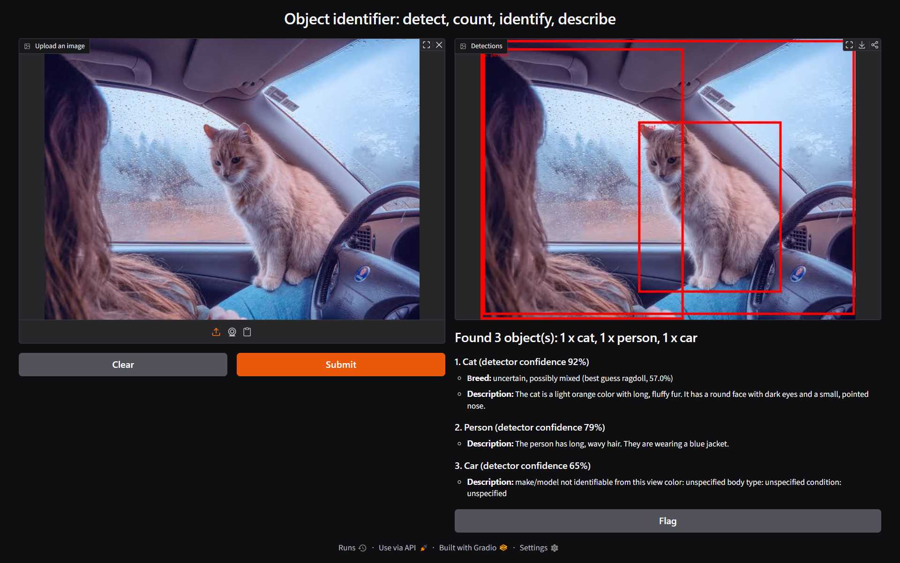
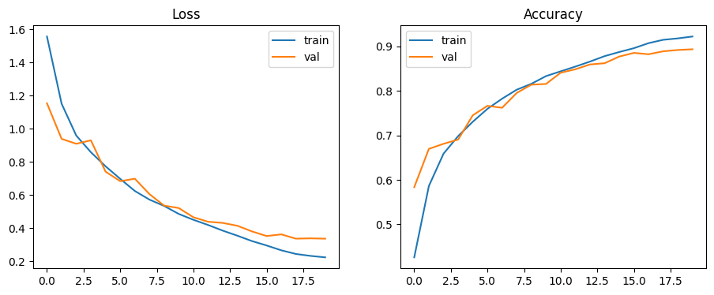
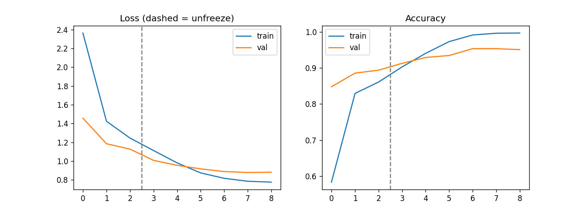

# Object Identifier: detect, count, name and describe objects in an image

Upload a photo and get back every object it contains, the count, a breed name for cats and dogs, and a short description of each object.

This repo is also a record of how I learned the full machine learning workflow: I trained a CNN from scratch, then fine-tuned a pretrained model, then combined trained and pretrained models into one pipeline. Every result below is measured on a held-out test set, and the failures are documented too.

## Demo



The pipeline found 3 objects (cat, person, car). For the cat, the breed model reports "uncertain, possibly mixed" instead of forcing a breed, because its best guess is under the 70% confidence threshold.

## How it works

```
Image -> YOLO11 detector -> crop each object -> cats/dogs: my fine-tuned breed model
                                             -> every object: Qwen2-VL short description
                                             -> report + annotated image (Gradio)
```

| Stage | Model | Trained by me? |
|---|---|---|
| Detect and count objects (80 COCO classes) | YOLO11m | No, pretrained |
| Breed of cats and dogs (37 breeds) | EfficientNet-B0 fine-tuned on Oxford-IIIT Pets | **Yes** |
| Short description of each object | Qwen2-VL-2B-Instruct | No, pretrained |

## Results (test set, used once)

| Experiment | Data | Model | Test accuracy |
|---|---|---|---|
| 1. CNN from scratch | CIFAR-10, 10 classes, 32x32 | 6-conv-layer CNN, 815k parameters | **88.88%** |
| 2. Transfer learning | Oxford-IIIT Pets, 37 breeds, 224x224 | EfficientNet-B0, pretrained on ImageNet | **91.47%** |





### What the errors showed
- **CIFAR-10:** cat vs dog is the worst pair (104 dogs called cats, 80 cats called dogs; cat F1 0.78). At 32x32 pixels, fur texture and ear shape are mostly gone. Vehicles score above 0.92.
- **Pets:** the model mixes up near-identical breeds: American Pit Bull Terrier to Staffordshire Bull Terrier (19), Ragdoll to Birman (15), Egyptian Mau to Bengal (15).
- **Overfitting:** the pets model reaches 99.7% train accuracy against about 95% validation. Validation loss stopped improving after epoch 4.
- The validation score (95.4%) is higher than the test score (91.5%) because the best epoch was chosen on the small validation set. The test number is the honest one.

## Limitations I found by testing it

1. **A closed-set classifier can't say "I don't know".** My CIFAR-10 CNN labeled a laptop as a ship (84.7%) and an elk as a deer (100%). Softmax always spreads 100% over the known classes.
2. **Mixed-breed dogs.** A street-dog photo got a flat 13.8% / 11.5% / 10.6% across three unrelated breeds. The pipeline now reports "uncertain, possibly mixed" below 70% confidence.
3. **Domain shift.** The 32x32 CIFAR model does much worse on real full-size photos, which is why I moved to transfer learning at 224x224.
4. **Vision-language model hallucinations.** On a photo showing only a car interior, the description named a specific car model that couldn't be read from the image. The prompt now tells the model to name a make or model only when a badge or logo is clearly visible.
5. **Overlapping boxes leak context.** A person's crop that includes a cat gets a description mentioning the cat. Fixing this properly needs instance segmentation to mask other objects.
6. **Only COCO's 80 classes are detected.** Things like deer or frogs are never found. An open-vocabulary detector (Grounding DINO or YOLO-World) would fix this.

## Run it

Google Colab with a T4 GPU:

```bash
pip install -q -U ultralytics transformers accelerate gradio
```

Put `pets_effnet_b0.pt` in the same folder as `object_pipeline.py`, then run it:

```bash
python object_pipeline.py
```

It prints a public Gradio link. Restart the Colab session before re-running the whole pipeline, because three models loaded twice can exhaust free-tier RAM.

To reproduce the training:

```bash
pip install -r requirements.txt
python object_classifier.py          # experiment 1, about 10 minutes on a T4
python pets_transfer_learning.py     # experiment 2, about 10 minutes on a T4
```

## Files

| File | Purpose |
|---|---|
| `object_classifier.py` | Experiment 1: CNN from scratch on CIFAR-10 (train, evaluate, predict) |
| `pets_transfer_learning.py` | Experiment 2: two-phase fine-tuning of EfficientNet-B0 on 37 breeds |
| `object_pipeline.py` | Final app: detector, breed model, descriptions, Gradio UI |
| `small_cnn_cifar10.pt`, `pets_effnet_b0.pt` | Trained weights |

## What I'd do next
- Train a car make/model specialist (Stanford Cars); the pipeline already loads one if `cars_effnet_b2.pt` is present.
- Swap in an open-vocabulary detector so any object can be found.
- Use instance segmentation to stop descriptions leaking between overlapping objects.
- Add confidence calibration or an explicit "other" class.

## Licenses and credits
Datasets: CIFAR-10, Oxford-IIIT Pets. Models: YOLO11 (Ultralytics, AGPL-3.0, check its terms before commercial use), Qwen2-VL-2B-Instruct (Apache 2.0), EfficientNet-B0 (torchvision).
